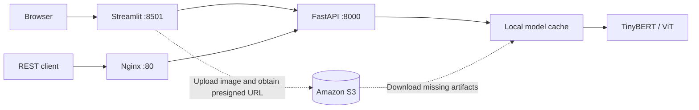

# Transformer Model Deployment on AWS

A course-based machine learning project connecting fine-tuned **TinyBERT** and **Vision Transformer (ViT)** models to a **FastAPI** inference service and a **Streamlit** interface. Model artifacts can be loaded from local storage or downloaded from **Amazon S3**, with **Docker Compose** and **Nginx** providing the deployment setup for an EC2 host.

The project follows [Deploy ML Model in Production with FastAPI and Docker](https://www.udemy.com/course/nlp-with-bert-in-python/) by Laxmi Kant / KGP Talkie. It includes my learning notes and experiments alongside an organized serving application. This is a learning and portfolio project; it does not claim a production deployment or measured service performance.

## What the project demonstrates

| Area | Implementation |
| --- | --- |
| NLP | TinyBERT fine-tuning for movie-review sentiment and disaster-tweet classification |
| Computer vision | ViT fine-tuning for human action/pose labels from images; this is image classification, not skeleton/keypoint estimation |
| Model serving | Three typed REST endpoints, request validation, model caching, and inference timing |
| Cloud integration | S3 model artifacts, image uploads with presigned URLs, and Boto3 EC2 exercises |
| Deployment | Separate API, Streamlit, and Nginx containers with a health check |
| Engineering | Environment configuration, offline API/storage tests, and GitHub Actions checks |

## Architecture



The API loads only the requested model on first use and retains it in memory for subsequent calls. The first request may download artifacts from S3. Each API worker has its own model cache. Streamlit sends requests from its Python server, so its `API_URL` must be reachable from that server.

## Run locally

Use **Python 3.11** to match the Docker image and the retained Torch/Transformers versions. Run commands from the repository root.

```bash
python3.11 -m venv .venv
source .venv/bin/activate
python -m pip install -r requirements.txt
python -m uvicorn api_main:app --reload --port 8000
```

Open [interactive API docs](http://localhost:8000/docs) or [health](http://localhost:8000/health). These work without model weights or AWS credentials. Prediction endpoints return `503` until their trained artifacts are available. Health reports process liveness, not model readiness.

In another terminal, activate the same environment and start the UI:

```bash
source .venv/bin/activate
python -m streamlit run model_serve_streamlit.py
```

Open [Streamlit](http://localhost:8501). The UI displays the predicted label, model confidence, inference time, and full JSON response.

### Supply trained models

Weights and datasets are intentionally excluded from Git. There are two supported artifact sources:

1. **Local folders:** train/export models using the notebooks, then copy their saved directories into this layout:

   ```text
   ml-model-dir/
   ├── tinybert-sentiment-analysis/
   ├── tinybert-disaster-tweets/
   └── vit-human-pose-classification/
   ```

   Include the full `Trainer.save_model(...)` export: model config, weights, tokenizer files for text models, and `preprocessor_config.json` for ViT. You only need the model you want to use. Set `MODEL_DIR` to the repository root if you want to serve the notebooks' original output folders directly.

2. **S3:** upload the same directories under `ml-models/` in your own bucket, configure Boto3 credentials, and export:

   ```bash
   export AWS_S3_BUCKET=your-model-bucket
   export AWS_DEFAULT_REGION=eu-north-1
   ```

   The API downloads missing directories automatically. Existing local directories take precedence; remove or replace an incomplete/outdated directory to download it again. Image uploads from Streamlit also require S3, even when models are local. Direct image URLs do not require an upload bucket.

See [deployment and configuration](docs/deployment.md) for container credentials and EC2 instructions.

## Run with Docker Compose

```bash
cp .env.example .env
mkdir -p ml-model-dir
docker compose up --build
```

| Service | Local address |
| --- | --- |
| Streamlit interface | http://localhost:8501 |
| API docs through Nginx | http://localhost/docs |
| API health through Nginx | http://localhost/health |

Edit `.env` to configure S3, or populate `ml-model-dir/` for local inference. Compose starts without artifacts so you can inspect the API; predictions still need trained weights. The first build installs Torch and can take time. Stop services with `docker compose down`.

**About the other Compose file:** `image: laxmimerit/app` and `image: laxmimerit/nginx` pull the instructor's prebuilt images. They are an alternative to building the course application, not an additional required file. This repository builds its own code, fixes the API entry point, and includes Streamlit. The local AWS credential mount is available separately in [docker-compose.aws-local.yml](docker-compose.aws-local.yml).

## API example

```bash
curl -X POST http://localhost:8000/api/v1/sentiment_analysis \
  -H 'Content-Type: application/json' \
  -d '{"texts": ["A thoughtful film with a great cast."], "user_id": "demo@example.com"}'
```

For Docker, use `http://localhost/api/v1/sentiment_analysis` instead.

| Method | Route | Input |
| --- | --- | --- |
| `GET` | `/health` | None |
| `POST` | `/api/v1/sentiment_analysis` | `texts`: list of reviews; `user_id`: email |
| `POST` | `/api/v1/disaster_classifier` | `texts`: list of tweets; `user_id`: email |
| `POST` | `/api/v1/pose_classifier` | `urls`: list of HTTP(S) image URLs; `user_id`: email |

Prediction responses contain `pred_model`, the original inputs, `labels`, `scores`, and `prediction_time` in milliseconds. Timing covers the pipeline call and excludes initial model loading. Image inference includes fetching and preprocessing the image. Text batches accept up to 32 nonempty items (10,000 characters per item), and image batches up to 8 URLs. Text longer than the model's context is truncated. `user_id` is retained from the course contract as request metadata; it does not authenticate users and is not stored by the application.

## Repository guide

```text
api/                         Request schemas, lazy model loading, S3 helpers
api_main.py                  FastAPI application
model_serve_streamlit.py      Main Streamlit client for all three models
app.py                       Earlier lesson: direct sentiment inference in Streamlit
streamlit_intro.py           Original Streamlit widget exercises
*_classification.ipynb       Model training, evaluation, and S3 export
boto_*.ipynb                 Exploratory AWS exercises
ec2_*_setup.ipynb             EC2 provisioning and day-to-day operations
data/                        Small assets used in the exercises
docs/                        Deployment, notebook guide, and portfolio wording
tests/                       API and S3 tests using mocked external dependencies
.github/workflows/           Automated checks
```

The notebooks stay at the root to preserve their relative paths. Original code comments and notebook explanations are retained; the abandoned multipart upload experiment is kept as a commented learning note in the Streamlit client. Saved AWS outputs were cleared to avoid publishing credentials and infrastructure responses. Training plots and metrics remain in the model notebooks.

## Development checks

```bash
python -m pip install -r requirements-dev.txt
python -m pytest -q
python -m ruff check .
python -m ruff format --check .
docker compose config --quiet
```

The development requirements are sufficient for the tests: no Torch, downloads, or AWS account are needed. Tests cover endpoint contracts with stub predictions and S3 transfer behavior with mocked clients. They do not verify trained-model accuracy or a live AWS deployment.

For training dependencies and notebook order, see the [learning guide](docs/learning-guide.md). For an accurate project description on a CV, see [portfolio notes](docs/portfolio.md).

## Scope and attribution

This is a single-host demonstration. Authentication, HTTPS termination, rate limiting, and monitoring are future work. Image URLs are fetched by the API; only use this demo with trusted users and inputs until outbound URL restrictions are added. Uploaded images remain in S3 after their one-hour links expire; configure retention for the `ml-images/` prefix if needed.

The course is the source of the training and deployment exercises. My learning comments, experiments, and this repository's integration are presented in that context. Dataset and pretrained model rights belong to their respective owners; inspect the sources linked in the notebooks before redistributing artifacts. No license for course-owned material is implied.
